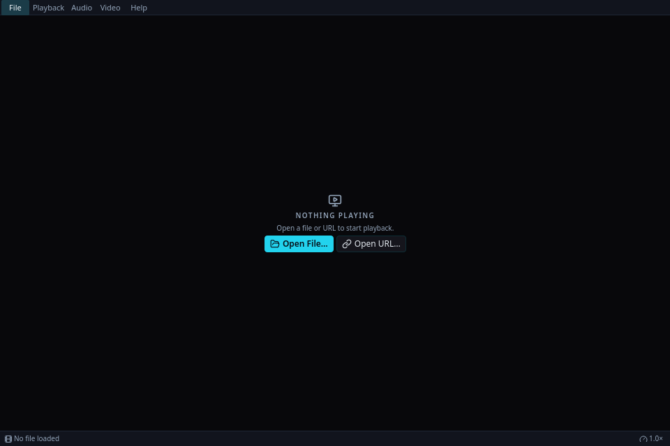

# QindaMPV

A Qt6/QindaTK media player for the QindaQt desktop, built on mpv. The whole
chrome — window, menus, transport island, dialogs — is native QindaTK QML;
playback comes from libmpv, loaded at run time.

## Screenshots

The native player’s startup window, before opening media.

[](docs/screenshots/startup.png)

QindaMPV — file and URL controls in the startup window.

[Capture notes](docs/screenshots/README.md).

## Features

- **mpv playback engine.** libmpv (`libmpv.so.2`) is resolved dynamically at
  startup — no build-time dependency on mpv headers or libraries. Without it
  the UI still runs and tells you what to install; with it, frames render
  through the mpv `render_gl` API into a Qt Quick OpenGL surface (the app
  forces the OpenGL RHI backend for this).
- **Global menu.** The full menu (File / Playback / Audio / Video / Help) is
  defined once as an AppShell action catalog and exported per window through
  the QindaQt desktop's first-party menu composition
  (`composeFirstPartyMenuExport`); the panel shows it for the focused
  window. Fail-closed: whenever the export is not live (foreign desktop, no
  session bus), the in-window QindaTK menu bar stays visible.
- **One dispatch path.** Panel menu, in-window menu, keyboard shortcuts and
  the transport island all activate the same action ids through the
  ApplicationCoordinator, so nothing can drift out of sync. Checkable items
  (Mute, Fullscreen, Subtitles Visible) mirror live player state.
- **QindaTK chrome.** Floating control island (play/pause, stop, chapter
  skip, seek bar, volume, speed chip, fullscreen) over the video, empty
  state with Open File/URL actions, status bar with title, chapter,
  playlist and speed fields. Chrome auto-hides in fullscreen.
- **mpv-native keys.** Space, arrows, `[` `]` speed, `9`/`0` volume, `m`
  mute, `j`/`v` subtitles, `f` fullscreen, `.`/`,` frame steps, PgUp/PgDn
  chapters — all listed in the menus.

## Usage

```
qqmpv [--screenshot PATH] [file|url...]
```

- Positional arguments are files or URLs (`QUrl::fromUserInput`); the first
  replaces the playlist, the rest are appended.
- `--screenshot PATH` renders the window and saves the first settled frame,
  then exits — used by packaging and harness verification (works under the
  offscreen platform).

## Keyboard shortcuts

| Keys | Action |
| --- | --- |
| `Space` | Play/Pause |
| `S` | Stop |
| `←` / `→` | Seek ±5 s |
| `Ctrl+←` / `Ctrl+→` | Seek ±1 min |
| `.` / `,` | Next / previous frame |
| `PgUp` / `PgDn` | Previous / next chapter |
| `<` / `>` | Previous / next in playlist |
| `[` / `]` / `Backspace` | Slower / faster / normal speed |
| `9` / `0` | Volume down / up |
| `M` | Mute |
| `#` | Cycle audio track |
| `J` / `V` | Cycle subtitles / subtitles visible |
| `F` (or double-click) | Fullscreen |
| `Shift+S` | Screenshot (to `~/Pictures/QindaMPV`) |
| `Ctrl+O` / `Ctrl+U` | Open file / URL |
| `Ctrl+Q` | Quit |
| `F1` | About |

## Build & install (Gentoo)

```
cmake -B build -DCMAKE_BUILD_TYPE=Release
cmake --build build
./build/qqmpv
```

The release channel is the `qindaqt` overlay: copy
`packaging/gentoo/media-video/qqmpv` into `/var/db/repos/qindaqt`, run
`ebuild …/qqmpv-<version>.ebuild manifest`, accept `~amd64` for the package
and `emerge media-video/qqmpv`. The ebuild pins `>=dev-qt/qtbase-6.11`,
`dev-libs/qindatk` and the QindaQt desktop libraries; playback needs
`media-video/mpv[libmpv]` at run time.

## Layout

```
src/main.cpp                  composition: coordinator + player + export
src/app/action_catalog.cpp    the one menu/action catalog (stable ids)
src/player/mpv_api.h          minimal libmpv ABI declarations (client + render_gl)
src/player/mpv_library.cpp    run-time libmpv resolution (all-or-nothing)
src/player/player_controller  QObject engine facade exposed to QML
src/player/mpv_video_item     QQuickFramebufferObject render node
qml/Main.qml                  window: menu twin, video, chrome, shortcuts
qml/PlayerMenuBar.qml         in-window fallback menu from coordinator.menus
qml/ControlIsland.qml         transport island (property-injected player)
qml/SeekBar.qml               seek slider + time readouts
```

## License

GPL-3-or-later.
